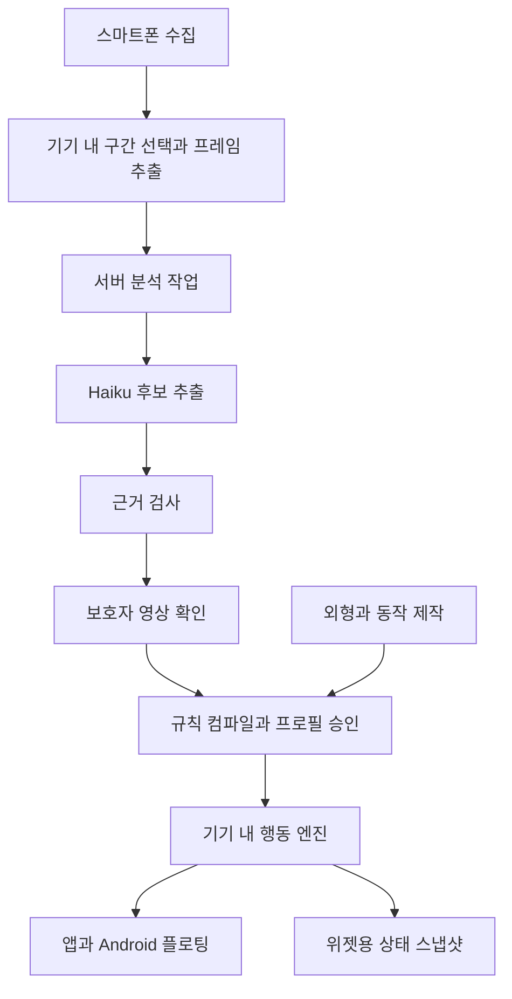

# Claude Haiku 5.5 기반 반려견 앱 상세 기획과 설계

원본: [ChatGPT 문서](https://chatgpt.com/space/page_8fca22aa5ebc81919fc79b040858f4b9)  
문서 시퀀스: 2  
내보낸 날짜: 2026-10-17 (Asia/Seoul)

이 파일은 이전 조사·설계의 보존본입니다. 현재 개발 기준은 [결정 기록](../decisions.md)과 [프로젝트 개요](../project-brief.md)를 우선 확인하세요. 내부 프로젝트 링크는 같은 폴더의 문서로 연결했습니다.

설계 버전 0.2 · 2026-10-17 · 대상: 개 · 기본 분석 모델: Claude Haiku 5.5

목표는 보호자가 스마트폰으로 제공한 외형과 행동 자료를 바탕으로, 작은 2D 캐릭터에서도 “우리 개 같다”고 느끼는 경험을 만드는 것이다. 첫 개인화는 반려견 한 마리, 대표 행동 세 가지로 검증한다. 이 수량과 아래 촬영 길이·성능 목표는 개발 범위를 정하는 초기값이며, 문헌으로 검증된 최소 수집량이나 달성된 성능이 아니다.

이 문서는 기술 구현의 작업 가정이다. 고객·시장 검증 M0를 먼저 수행하고, 실제 행동 재현의 추가 가치와 자료 제공 부담을 확인한 뒤 기능·유료 범위를 조정한다. 기존 문헌검토와 데이터 수집 기준을 계승하며, 개체 식별 효과와 Haiku의 개 행동 분석 정확도는 앞으로 평가한다. 앱·서버·애니메이션의 구현 완료를 뜻하지 않는다.

[목표 사용자와 시장 및 경쟁사 분석](./06_market_competitors.md)에 초기 고객 가설, 기존 서비스와의 중복, 공개 가격과 고객 검증 계획을 정리했다.

관련 문서: [개발 지침과 첫 시제품](./00_project_guidance.md) · [행동과 습관 문헌검토](./02_dog_identity_literature.md) · [데이터 목록·위계·우선순위](./01_data_hierarchy.md) · [2D·3D 움직임 문헌과 적용안](./03_animation_literature.md) · [Jev·스마트폰 구현 검토](./04_jev_feasibility.md)

이번 설계에서는 분석 모델의 작업 가정을 Haiku 5.5로 구체화한다. 기존 Jev 검토는 당시 대안 검토 자료로 보존한다.

# 1. 제품 목표와 설계 결정

| 항목 | 이번 설계의 기본값 | 검증할 문제 |
| --- | --- | --- |
| 핵심 경험 | 외형과 상황별 행동 순서·타이밍을 반영한 개인 반려견 | 보호자가 일반 캐릭터보다 자기 개답게 느끼는가 |
| 수집 장치 | 보호자의 스마트폰 사진·짧은 영상·직접 기록 | 장비 추가 없이 필요한 장면을 확보할 수 있는가 |
| AI 역할 | 외형 설명, 행동 후보 추출, 보호자 기록 구조화 | 근거가 없는 후보와 누락이 어느 정도인가 |
| 행동 실행 | 확정된 프로필과 동작 자산을 이용한 기기 내 규칙 실행 | 통신 없이도 일관되고 자연스럽게 움직이는가 |
| 표시 순서 | Android 플로팅 검증 → 개인화 → Android·iOS 앱과 위젯 | 실제 기기의 권한·터치·배터리 조건을 만족하는가 |
| 표현 | 제한된 시점의 2D, 미리 제작한 동작 클립 | 작은 크기에서도 무늬와 대표 동작이 식별되는가 |
| 첫 개인화 | 한 마리, 기본 동작 8종, 대표 행동 최대 3개 | 작업량과 보호자 수정 부담이 감당 가능한가 |

‘디지털 트윈’은 프로젝트 작업명이다. 서비스 설명은 “사진과 기록을 바탕으로 외형과 익숙한 행동을 반영한 캐릭터”로 작성한다. 실제 개의 현재 상태를 원격으로 보여주거나 마음을 읽는 기능으로 설명하지 않는다. 고양이, 정밀 관절 복원, 3D, 실제 발성 복제, 상시 카메라 관찰은 후속 범위다.

# 2. Haiku 5.5 적용 방식

공식 문서상 모델 ID는 `claude-haiku-5-5`이며 입력은 텍스트·이미지, 출력은 텍스트다. 따라서 스마트폰 영상은 프레임과 시각 정보로 변환해 전달하고, 동작 그림은 별도로 제작한다. 모델의 일반적인 추출 기능이 이 프로젝트의 개 행동 분석 성능을 보장하지는 않는다. [모델 공식 문서](https://platform.claude.com/docs/en/models/haiku-5-5/overview)

| 작업 | Haiku 입력 | 출력과 다음 단계 |
| --- | --- | --- |
| 외형 특징 후보 | 방향이 표시된 사진, 보호자 수정사항 | 털색·무늬·귀·꼬리·체형 설명 → 외형 제작 명세 |
| 장면 행동 후보 | 같은 장면의 순서 있는 프레임, 프레임 ID·시각, 맥락 | 허용된 행동 코드와 근거 프레임 → 영상 확인 카드 |
| 보호자 설명 정리 | 원문 응답과 관련 장면 ID | 상황·행동·반복에 관한 보고 항목 → 보호자 보고 저장 |
| 대표 행동 설명 | 확인된 기록과 사용 가능한 동작 목록 | 설명·매핑 초안 → 규칙 검사와 사용자 미리보기 |
| 프로필 수치 계산 | 별도 AI 작업으로 두지 않음 | 확인된 시각·횟수로 코드가 계산 |
| 평소 캐릭터 재생 | API를 호출하지 않음 | 기기 내 행동 엔진과 렌더러가 처리 |

초기 연결은 Claude 직접 API와 JSON 구조화 출력을 사용한다. `output_config.format`에 제한된 스키마를 지정하고, 서버에서도 값의 범위와 근거 연결을 검증한다. 형식에 맞는 JSON은 관찰 내용이 맞다는 증거가 아니다. 거절·출력 잘림은 정상 프로필로 처리하지 않는다. 플랫폼별 지원 차이가 있으므로 다른 공급 경로로 바꿀 때 별도 호환 검사를 한다. [구조화 출력 공식 문서](https://platform.claude.com/docs/en/build-with-claude/structured-outputs)

모델 ID, 프롬프트 버전, 스키마 버전, 사용량, 응답 종료 사유를 작업별로 저장한다. 추론 깊이와 출력 한도는 샘플 평가 후 고정하며, 출력 한도를 지나치게 줄여 결과가 잘리지 않게 한다. 최신 문서에 맞춰 샘플링 파라미터는 기본적으로 생략한다. 개별 반려견마다 모델을 새로 학습하지 않고, 개별성은 프로필과 동작 자산으로 유지한다.

# 3. 사용자 흐름과 화면

| 화면 | 사용자의 과업 | 다음 단계로 넘길 결과 |
| --- | --- | --- |
| 시작 | 기능 설명을 보고 임시 캐릭터를 만져보기 | 기기 내 체험. 자료 업로드 없이 진입 |
| 내 반려견 | 이름·외형 사진 등록, 아는 기본 정보 입력 | 개체 ID와 방향별 사진 |
| 우리 개다운 장면 | 대표 상황 하나를 고르고 사진첩 영상 선택 또는 촬영 | 장면 ID, 보호자가 고른 이유 |
| 분석 준비 | 자르기·대상 개체·전송 프레임 확인 | 업로드 범위와 분석 동의 |
| 행동 확인 | 원본 구간을 보며 후보 수락·수정·제외 | 출처가 붙은 확인 기록 |
| 닮은 행동 만들기 | 동작 미리보기, 순서와 속도 조정 | 적용 전 프로필 초안 |
| 함께 있기 | 부르기·장난감 제시·접근 같은 가상 상호작용 | 기기 내 재생, 필요 시 플로팅 설정 |
| 더 닮게 하기 | 다른 날의 장면 추가, 달라진 행동 확인 | 새 프로필 버전 또는 기존 버전 유지 |
| 관리 | 자료·캐릭터 삭제, 표시 중지, 외형·행동 되돌리기 | 삭제 상태와 활성 버전 확인 |

첫 진입에서 모든 자료를 요구하지 않는다. 사진을 등록하고 장면 하나를 확인한 뒤 첫 개인화를 보여주며, 대표 행동 세 가지까지 점진적으로 확장한다. Android의 다른 앱 위 표시 권한은 ‘화면 위에 함께 있기’를 선택했을 때 요청한다. 권한을 허용하지 않아도 앱 안에서 사용할 수 있다.

행동 확인 카드에는 “이 구간에서 고개를 돌렸어요”, “이렇게 행동한다고 알려주셨어요”, “잘 보이지 않아 확인이 필요해요”처럼 출처를 드러낸다. 검증되지 않은 ‘신뢰도 93%’는 표시하지 않는다. 후보가 없으면 직접 등록하거나 다른 장면을 선택할 수 있게 한다. 분석 중에도 기존 캐릭터는 사용할 수 있고, 처리 건수를 보여주되 실측 전 완료 시간을 약속하지 않는다.

# 4. 스마트폰 수집 계획과 우선순위

| 우선순위 | 수집 항목 | 초기 입력 방식 | 구현 연결 |
| --- | --- | --- | --- |
| P0 | 얼굴·전신·좌우 외형 | 권장 사진 4장. 한 사진이 여러 방향 요건을 충족해도 허용 | 무늬·체형·귀·꼬리 제작 |
| P0 | 보호자가 고른 대표 장면 | 먼저 1개, 최대 3개. 각 15~30초를 출발점으로 하고 필요한 전후 구간 보존 | 개인화 후보 |
| P0 | 장면 맥락 | 자극, 대상, 촬영일, 참여자, 직전 활동, 대표 장면/계획 관찰 여부 | 상황별 규칙 |
| P0 | 행동의 관찰 근거 | 시작·종료, 첫 반응, 순서·반복, 가시성, 보호자 반응 | 시간과 전환 |
| P0 | 다른 날의 같은 상황 | 장면별 서로 다른 3일 수집을 파일럿 목표로 설정 | 반복 여부 확인. 충분성을 보장하는 수량은 아님 |
| P0 | 보호자 확인과 수정 | 실제 장면의 내용 확인, 대표성 설명, 재생 결과 평가 | 관찰·보고·제작 조정의 구분 |
| P1 | 생활 리듬·기다림·원음 | 계획 관찰과 자연 발생 자료를 추가 | 생활 범위 확장 |
| P2 | 정밀 보행·관절·표정 | 핵심 재현 문제가 확인됐을 때 추가 | 전문 모션 처리 또는 3D |

상황은 보호자가 중요하게 여기는 것부터 선택한다. 초기 선택지는 평소처럼 이름 부르기, 익숙한 장난감 제시, 자연스러운 접근·요구 행동이다. 쉬기 전 행동도 대표 후보로 선택할 수 있다. 자극에 반응하지 않는 장면도 보존하며, 촬영을 위해 불편한 자극이나 장시간 기다림을 만들지 않는다.

반복 관찰에서 반응률을 계산하려면 정해 둔 관찰 기회를 반응 여부와 관계없이 기록해야 한다. 잘 나온 영상만 모은 자료에서는 동작 후보와 순서를 추출할 수 있지만 일상 발생확률을 계산하지 않는다. 하루 활동량과 수면 비율은 짧은 영상으로 만들지 않는다. 세부 행동 정의와 문헌별 근거는 [기존 수집 기준](./01_data_hierarchy.md)을 따른다.

# 5. 영상 처리와 측정의 한계

원본은 스마트폰에 유지하고, 선택한 구간의 프레임을 분석에 사용한다. 초기 샘플러는 장면의 양 끝을 포함한 최대 12개 프레임을 균등하게 뽑는다. 필요한 후보 구간에 한해 최대 12개 프레임을 추가하는 2차 분석을 허용한다. 이는 비용과 확인 부담을 제한하는 실험 설정이며, 12개 프레임으로 모든 행동을 포착할 수 있다는 뜻이 아니다.

프레임마다 원본의 실제 표시 시각과 추출·회전·자르기 정보를 저장한다. 가변 프레임률 영상의 시각을 ‘프레임 번호 ÷ 30’으로 대체하지 않는다. 해상도는 털무늬·부위 가시성과 토큰 사용량을 비교해 정하고, 원본을 낮은 해상도 파일로 덮어쓰지 않는다.

| 문제 | 저장과 처리 규칙 |
| --- | --- |
| 빠른 고개 움직임·꼬리 리듬 | 성긴 프레임으로 확인되지 않으면 미상. 원본 영상 확인 또는 별도 모션 처리로 넘김 |
| 자극이 프레임에 안 보임 | 촬영된 음성·동작을 보호자가 원본에서 표시. 시작을 확인할 수 없으면 지연 계산 제외 |
| 움직임 시작이 프레임 사이에 있음 | 마지막 미발생 프레임과 첫 발생 프레임 사이의 구간으로 보존 |
| 촬영 종료까지 반응 없음 | 무반응과 관찰 시간을 기록. 지연 0초로 저장하지 않음 |
| 가림·화면 이탈 | 관찰 불가와 행동 종료를 구분 |
| 개가 여러 마리 등장 | 대상 개체를 확인하거나 구간을 잘라 사용. 구분이 안 되면 분석 보류 |
| 원본 삭제 | 근거 재확인 불가 표시. 기존 수치를 새 관찰값으로 재생성하지 않음 |

Haiku가 반환한 프레임 ID를 서버가 원본 시각에 대응시키고, 보호자가 원본에서 확인한 시점으로 측정값을 갱신한다. 예를 들어 1초 간격 자료에서 0.1초 단위의 정밀 반응 지연을 확정하지 않는다. 촬영 중 버튼을 누른 시각도 자극이 실제로 시작한 시각과 일치한다고 자동 간주하지 않는다.

음성은 초기 Haiku 분석 입력에서 제외한다. 이름 부르기처럼 소리가 자극인 경우 보호자가 원본을 듣고 시작점을 표시한다. 자동 음성 인식은 후속 선택 기능으로 분리한다.

# 6. 데이터 위계와 출처 관리

기본 위계는 개체 → 관찰 회차 → 상황 장면 → 행동 사건이다. 프로필은 원자료를 참조하는 파생 자료이며, 사용자 평가는 별도로 연결한다. 아래 테이블은 구현용 데이터 구조 제안이다.

| 저장 단위 | 핵심 필드 | 연결과 역할 |
| --- | --- | --- |
| Pet | pet_id, 이름, 아는 기본 정보, 외형 버전 | 개인화의 단위 |
| CaptureSession | session_id, 날짜·시간, 참여자, 맥락 | 관찰 회차 |
| Episode | episode_id, 수집 방식, 자극·대상, 관찰 범위, 종료 사유 | 분모와 상황 정의 |
| MediaAsset | asset_id, 로컬 원본 참조, 파일 해시, 시각 기준, 삭제 상태 | 출처 보존 |
| EvidenceFrame | frame_id, asset_id, 원본 시각, 변환 정보 | AI 근거 연결 |
| ObservationCandidate | 행동 코드, 근거 프레임, 가시성, 후보 상태, 분석 작업 ID | 아직 확인되지 않은 후보 |
| ReviewedObservation | 코드, 확인된 구간·시각, 확인자, 코딩 기준 버전 | 사람이 확인한 영상 기록 |
| OwnerReport | 보호자 원문, 정리된 항목, 날짜, 관련 장면 | 보고 자료 |
| BehaviorProfile | 버전, 상황 규칙, 수치 출처, 근거 ID, 승인 상태 | 재생에 적용할 개인화 |
| AnimationAsset | 동작 ID, 자산 버전, 진입·종료 자세, 변형 가능 범위 | 실제 재생 가능한 동작 |
| RuntimeEvent | 가상 입력, 선택된 행동, 앱·프로필 버전 | 앱 사용과 오류 분석 |
| Evaluation | 평가 조건, 개체·평가자 ID, 선택·점수·이유 | 자기 개다움과 식별 평가 |
| AnalysisJob | 요청 해시, 모델·프롬프트·스키마 버전, 상태, 사용량 | 재현·비용·재시도 관리 |

출처와 확인 상태는 서로 다른 필드다. 출처는 `video_observation`, `owner_report`, `derived`, `design_default`로 구분하고, 확인 상태는 후보·검토 완료·제외로 둔다. 보호자가 설명을 승인해도 출처는 보호자 보고로 남는다. 모델은 이 구분을 임의로 바꿀 수 없다.

원자료를 덮어쓰지 않고 수정 이력을 남긴다. 행동 프로필의 각 값에는 근거 ID, 관찰 기회 수, 판정 불가 수, 관찰 일수, 계산 방식이 붙는다. 앱에서 캐릭터를 여러 번 만진 기록은 실제 반려견의 관찰 자료에 합치지 않는다. 보호자가 재생을 느리게 조정한 값은 ‘제작 조정’으로 남기고 원래 측정값과 분리한다.

# 7. AI 출력 계약과 프로필 확정

행동 추출은 장면 단위로 요청한다. 영상에 대한 보호자 설명은 별도 보고 필드로 제공해, 관찰된 것과 설명된 것을 혼합하지 않게 한다. 장면에 보이는 글자나 메타데이터는 분석 자료이며 실행 지시로 처리하지 않는다.

| 출력 필드 | 허용 내용 | 서버 검사 |
| --- | --- | --- |
| episode_id | 요청한 장면 ID | 요청과 일치 |
| behavior_code | 정해 둔 코드 또는 unknown | 행동 사전의 허용값 |
| evidence_frame_ids | 실제 제공된 프레임 ID 배열 | 해당 사용자·장면의 프레임인지 확인 |
| onset_bracket | 시작 전후의 근거 프레임 ID 또는 null | 시각 순서와 구간 범위 확인 |
| offset_bracket | 종료 전후의 근거 프레임 ID 또는 null | 종료 미확인 허용 |
| visibility | visible, partial, occluded, out_of_frame, unknown | 허용값 검사 |
| target | person, toy, food, other, unknown | 프레임에서 확인되지 않으면 unknown |
| observation_note | 짧은 관찰 설명 | 감정·의도 단정은 검토 대상으로 표시 |
| missing_information | 미확인 항목 배열 | 빈 자료를 임의 수치로 채우지 않음 |

초기 코드 사전은 서 있음, 앉음, 누움, 걸음, 고개 방향 전환, 접근, 접촉, 앞발 들기, 꼬리 움직임, 관찰 불가로 시작한다. 각 코드에 포함·제외 예시와 시작·종료 기준을 작성한다. ‘고개가 사람 쪽을 향함’을 눈맞춤으로 확장하지 않고, 가만히 누워 있는 것을 수면으로 확정하지 않는다. 이 사전은 개발용 관찰 기준이며 타당화된 심리척도가 아니다.

후보 → 보호자 영상 확인 → 관찰 기록 저장 → 규칙 컴파일 → 재생 미리보기 → 프로필 적용 순서로 진행한다. 승인되지 않은 후보는 활성 프로필에 들어가지 않는다. 필수 근거 누락, 허용하지 않은 행동, 자산 미존재, 잘못된 시간 순서는 컴파일 단계에서 차단한다. 학습된 확률을 흉내 내는 숫자를 만들지 않는다.

반응 지연·지속·반응률은 코드로 계산한다. 기록이 적을 때는 관찰된 사례와 범위를 보여준다. 미발생·중단 사례를 제외하고 ‘일반적인 반응 속도’로 단정하지 않는다. 조건이 맞는 반복 자료가 쌓인 뒤 요약 방법과 불확실성 표시를 정하고 버전으로 관리한다.

# 8. 개인화 행동과 2D 애니메이션

개인화는 외형, 동작 형태, 상황별 동작의 순서·타이밍으로 나누어 제작한다. 기본 동작 8종은 움직이지 않는 기본 자세, 걷기, 고개 돌리기, 앉기, 눕기, 일어나기, 꼬리 흔들기, 앞발 들기로 제안한다. 잠든 모습은 표시용 자세로 만들 수 있지만, 실제 수면 상태를 추정하는 기능과 연결하지 않는다.

사진에서 바로 완성된 일러스트·리깅·동작이 나오는 공정을 Haiku에 맡기지 않는다. 첫 개체는 제작자가 사진을 보고 레이어 일러스트와 필요한 전환을 제작한다. 생성형 이미지 도구를 도입한다면 별도 제작 단계로 평가한다. 장기적으로 자동화할 영역도 첫 개체에서 수정 시간과 실패 유형을 측정한 뒤 선택한다.

| 제작 산출물 | 포함할 내용 | 완료 기준 |
| --- | --- | --- |
| 외형 명세 | 좌우 무늬, 얼굴·몸 비율, 귀·꼬리 형태, 식별 특징 | 보호자가 정면과 측면 미리보기 확인 |
| 원본 일러스트 | 몸통·머리·귀·꼬리·다리 등 필요한 레이어 | 동작에서 찢어짐·겹침이 없는지 확인 |
| 동작 클립 | 투명 배경 프레임, 기본 8fps·125ms, 프레임별 유지 시간, 길이, 반복 여부, 이동량 | 작은 표시 크기에서 형태 유지. 탭·드래그 입력 처리와 프레임 갱신 분리 |
| 전환 클립 | 서기↔앉기, 앉기↔눕기 등 필요한 연결 | 자세가 갑자기 바뀌지 않음 |
| 자산 명세 | clip_id, 방향, 진입·종료 자세, 기준점, 버전 | 행동 엔진이 로딩·전환 가능 |
| 대표 행동 레시피 | 상황, 순서, 대기·지속·반복, 종료 | 근거 장면과 비교 가능 |

좌우 무늬가 다른 개는 한쪽 그림을 단순 반전한 결과가 맞는지 확인한다. 초기 시점을 제한하더라도 양쪽 무늬와 비대칭 특징은 별도로 기록한다. 걸음 속도 조정은 허용 범위 안에서만 하고, 실제 보행 특징이 다르면 별도 클립을 제작한다. 화면상 픽셀 이동량을 실제 개의 이동 속도로 설명하지 않는다.

대표 행동은 기본 클립을 조합할 수 있는 것부터 구현한다. 예를 들어 ‘부르면 고개를 돌린 뒤 잠시 멈추고 접근’, ‘장난감을 보고 다가온 뒤 앉아서 기다림’, ‘앞발을 들었다가 기다린 뒤 한 번 더 들기’가 가능하다. 이는 동작 매핑 예시이며 해당 개에게 실제로 관찰돼야 개인화로 적용한다. 몸 전체 털기나 눕기 전 원 돌기처럼 없는 동작이 중요하면 제작 항목을 추가하고, 지원 전에는 비슷한 기본 동작으로 몰래 대체하지 않는다.

# 9. 기기 내 행동 엔진

행동 엔진은 현재 자세, 실행 중인 클립, 입력 상황, 프로필 버전을 받아 다음 클립을 선택한다. 같은 입력이 매번 동일한 반응을 요구하지는 않지만, 관찰 근거가 없는 무작위 행동을 그 개의 습관으로 표시하지 않는다. 자료가 없는 상태의 기본 행동은 공통 제작값으로 관리한다.

| 규칙 | 설계 |
| --- | --- |
| 입력 | 부르기 버튼, 장난감 제시, 캐릭터 접촉, 드래그 종료, 화면 사용 상태 |
| 상황 대응 | 실제 부르기와 앱의 부르기 버튼처럼 대응 관계를 명시. 가상 입력은 제작 가정으로 기록 |
| 순서 | 프로필이 허용한 동작 순서와 전환 그래프 사용 |
| 타이밍 | 확인된 지연·지속을 우선 사용. 제작 조정은 별도 보존 |
| 중복 입력 | 실행 중 입력을 병합하거나 제한. 반복 탭으로 동작이 무한 적체되지 않음 |
| 우선 처리 | 표시 중지·권한 해제 → 드래그 → 직접 상호작용 → 기본 행동 |
| 예외 | 지원하지 않는 자산·규칙은 안전한 기본 자세로 복귀하고 오류 기록 |
| 업데이트 | 자산과 프로필 호환 검사 후 동작 경계에서 함께 적용. 이전 버전으로 복귀 가능 |
| 오프라인 | 이미 받은 외형·동작·프로필로 실행. 분석 요청은 연결 후 재개 |
| 재현 평가 | 입력 시나리오와 난수 시드를 고정해 버전 간 비교 |

입력 인식 피드백과 개인화된 반응 지연을 분리한다. 누르기 피드백은 즉시 주고, 그 뒤 실제 개처럼 잠깐 기다렸다가 고개를 돌릴 수 있다. 사용자가 앱이 멈췄다고 느끼지 않도록 입력 처리 여부를 보여준다.

화면 밖에서 실제 개가 무엇을 하는지는 알 수 없다. 캐릭터의 현재 행동은 프로필에 따른 가상 재생이다. 시간대에 맞춘 행동은 관찰 자료나 보호자 설정이 있을 때 적용하고, 그 출처를 유지한다.

# 10. 시스템 구성과 API 경계

Android 기술 검증은 Kotlin 네이티브 표시 계층을 기본안으로 한다. iOS 앱·위젯도 OS에 맞는 표시 계층을 두고, 프로필 규격·행동 코드·동작 자산·전환 명세·검증 시나리오를 공유한다. 크로스플랫폼 UI 프레임워크 채택은 기술 검증 뒤의 구현 선택으로 남겨두되, 데이터와 자산은 특정 엔진에 종속시키지 않는다.

서버는 사용자 인증, 비공개 업로드, 분석 작업 큐, Haiku 어댑터, 근거 검사, 프로필 버전 관리를 담당한다. API 키는 서버에만 둔다. G0의 표시 검증은 계정·서버 없이 수행하고, G1의 외부 분석부터는 작은 인증 서버가 필요하다. 파일럿은 초대된 테스트 사용자로 제한하고, 공개 서비스의 계정·기기 변경·복구는 별도 출시 항목으로 둔다.

| 앱 서버의 제안 인터페이스 | 역할 |
| --- | --- |
| POST /media-sessions | 분석에 필요한 프레임 업로드 권한과 만료시간 발급 |
| POST /analysis-jobs | 장면·모델·프롬프트·스키마 버전으로 분석 생성 |
| GET /analysis-jobs/{id} | 처리 상태와 검증된 후보 조회 |
| POST /observations/{id}/reviews | 확인·수정·제외 기록 저장 |
| POST /profiles/compile | 확인 자료와 사용 가능한 자산으로 프로필 초안 생성 |
| POST /profiles/{version}/activate | 승인한 버전 적용 |
| DELETE /pets/{id} | 관련 자료 삭제 요청과 진행 중 작업 취소 |

이는 앱 서버의 제안 API이며 Claude의 API 경로가 아니다. 모든 요청은 소유권을 확인한다. 중복 분석은 미디어 해시·장면 범위·모델·프롬프트·스키마 버전을 묶은 키로 방지한다. 삭제 중이거나 삭제된 개체의 늦게 도착한 분석 결과는 저장·재활성화하지 않는다.

작업 상태는 대기, 업로드 중, 분석 중, 확인 대기, 완료, 실패, 취소로 둔다. 네트워크 오류·일시적 제한만 정해진 횟수 내에서 재시도하고 지수 지연과 공급자의 대기 안내를 따른다. 초기 자동 재시도는 최대 2회로 제한한다. 잘림·거절·근거 불일치 결과는 검토 또는 수동 입력으로 전환하며, 반복적인 AI 수정 요청으로 비용이 무한 증가하지 않게 한다.

# 11. 플랫폼별 표시와 기술 검증

| 표면 | 제공할 경험 | 설계 경계 |
| --- | --- | --- |
| Android 앱 | 동작 전체 재생, 수집·확인·편집 | 앱이 보이는 동안 상호작용 |
| Android 플로팅 | 작은 캐릭터, 탭·드래그, 대표 행동 | 사용자 권한과 OS 표시·서비스 조건 적용 |
| iOS 앱 | Android와 같은 개인화 자료·대표 행동 | 앱 안에서 지속 애니메이션 |
| Android 홈 위젯 | 캐릭터 상태 이미지와 앱 진입·지원되는 액션 | 플로팅의 프레임 루프를 위젯에 이식하지 않음 |
| iOS 홈 위젯 | 상태 이미지, 지원되는 버튼, 짧은 상태 전환 | 계속 걷는 캐릭터 대신 OS가 허용한 갱신과 전환 |
| iOS 다른 앱 위 자유 플로팅 | 첫 범위에 포함하지 않음 | 홈 위젯과 앱 내 경험을 제공 |

Android 오버레이는 일반 앱 화면 위에 표시할 수 있지만 중요한 시스템 창 아래에 놓이며, 다른 앱이 오버레이를 숨기도록 요청할 수도 있다. ‘항상 모든 화면에 보임’을 제품 약속으로 삼지 않는다. 서비스는 사용자가 보이는 앱 화면에서 켤 때 시작하는 흐름으로 설계하고, 백그라운드 자동 시작에 의존하지 않는다. [오버레이 명세](https://developer.android.com/reference/android/view/WindowManager.LayoutParams) · [오버레이 숨김](https://developer.android.com/about/versions/12/features) · [서비스 시작 제한](https://developer.android.com/develop/background-work/services/fgs/restrictions-bg-start)

플로팅 창은 캐릭터와 조작에 필요한 작은 영역으로 제한한다. 바깥 영역의 터치를 가로채지 않는지 실제 앱 조합에서 검사한다. 전면 투명 창으로 모든 터치를 처리하는 구현을 기본안으로 두지 않는다. 화면 꺼짐·표시 중지·권한 철회 시 렌더링을 중지하고, 알림에서 종료할 수 있게 한다. 사용할 foreground service 유형과 배포 요건은 G0에서 확인할 기술 관문이다. OS 정책에 맞는 방식이 성립하지 않으면 플로팅 출시 범위를 조정한다.

Apple 문서는 위젯·Live Activity의 상태 변화 애니메이션을 최대 2초로 제한한다. 따라서 위젯은 상태와 짧은 반응을 보여주고, 연속 행동은 앱에서 제공한다. Live Activity를 무제한 상주 캐릭터의 우회 수단으로 쓰지 않는다. [Apple 애니메이션 문서](https://developer.apple.com/documentation/widgetkit/animating-data-updates-in-widgets-and-live-activities)

# 12. 자료 보관과 비용 통제

| 자료 | 초기 보관안 | 사용자 제어 |
| --- | --- | --- |
| 원본 사진·영상·음성 | 스마트폰. 앱의 관리 복사본 여부를 표시 | 앱 보관 자료 삭제와 사진첩 원본 삭제를 구분 |
| 분석용 선택 프레임 | 비공개 서버 저장소, 초기 보존 기간 7일 | 분석 전 확인·개체 삭제 시 제거 |
| 확인 근거 | 로컬 원본 참조와 프레임 시각, 서버에는 필요한 메타데이터 | 원본이 없으면 재확인 불가 표시 |
| 행동 프로필·자산 | 기기 저장, 파일럿 서버에 버전 보관 | 버전 되돌리기·개체 삭제 |
| 운영 기록 | 작업 상태·사용량·오류 코드 | 원본 영상·보호자 자유응답을 일반 로그에 남기지 않음 |

분석 프레임의 7일 보존은 제안 기본값이며 공급자의 보존 정책을 뜻하지 않는다. 서비스에 표시할 자료 처리 안내에는 앱 서버와 AI 공급자의 처리 범위를 각각 확인해 반영한다. 삭제는 앱의 활성 자료·저장소·진행 중 작업에 일관되게 적용하고, 백업과 공급자 측 보존은 실제 계약과 시스템에 맞게 설명한다. 영상 속 다른 사람이나 집 내부가 불필요하게 전송되지 않도록 기기에서 자르기와 미리보기를 제공한다.

분석 호출은 등록·자료 추가·사용자가 선택한 재분석에 한정한다. 평소 캐릭터 재생에는 API 호출이 없다. 사용자별 작업 수와 프레임 수를 제한하고, 예상 토큰·실제 사용량·재시도를 계측한다. 장면 전체를 다시 보내는 대신 변경된 장면만 처리한다.

공식 표준 가격은 요청 프롬프트가 100,000토큰 이하일 때 입력 100만 토큰당 $0.10, 출력 $0.50이다. 이를 넘는 요청은 입력 $0.50, 출력 $2.50 구간이므로 요청별 입력량을 확인한다. 아래는 캐시·할인·세금을 제외한 계산 예시이며 영상 길이에서 실제 토큰 수를 예측한 값이 아니다. [공식 가격](https://platform.claude.com/docs/en/models/haiku-5-5/overview)

| 가정한 처리 | 입력·출력 토큰 | 모델 비용 예시 |
| --- | --- | --- |
| 장면 분석 1회 | 입력 10,000, 출력 1,000 | $0.0015 |
| 위 분석 6회 | 입력 합계 60,000, 출력 합계 6,000 | $0.0090 |
| 설명·매핑 초안 1회 | 입력 15,000, 출력 2,000 | $0.0025 |
| 위 7회 합계 | 모두 개별 요청 100,000 입력 이하 | $0.0115 |

실제 비용에는 이미지 입력, 추론에 따른 과금 토큰, 실패·재시도, 서버·저장·전송과 사람이 확인하고 동작을 제작하는 시간이 영향을 준다. 첫 파일럿에서 사용자당 총비용과 작업 시간을 함께 측정한다. 이 단계에서는 모델 단가만으로 구독료나 수익성을 결정하지 않는다.

# 13. 검증 지표와 통과 기준

검증은 표시 안정성, AI 추출, 개인화 효과를 분리한다. 정형 출력 성공률만으로 행동 분석 정확도를 판단하지 않는다. 아래 수치 목표는 개발용 출발점이며 파일럿 결과에 따라 조정한다.

| 검증 영역 | 방법·지표 | 첫 관문 |
| --- | --- | --- |
| 표시·종료 | 앱 전환, 드래그, 화면 경계, 회전, 화면 끔, 권한 해제, 프로세스 종료 | 터치 방해·표시 잔류·중지 실패를 해결 |
| 반응성 | 입력 처리 피드백의 지연, 렌더링 프레임 시간 | 입력 피드백 P95 100ms 이내를 초기 목표로 측정. 개인화 대기시간과 분리 |
| 자원 사용 | 동일 밝기·앱 사용 시나리오에서 플로팅 켬/끔 비교 | 배터리·CPU·메모리·발열을 실측하고 허용 예산 결정 |
| AI 사건 추출 | 사람이 코딩한 영상 대비 코드별 정밀도·재현율·판정 보류율 | 어떤 코드를 자동 제안할지 오류 유형별 결정 |
| 시간 기록 | 원본 코딩과 시작·종료 구간 비교 | 입력 프레임 간격보다 정밀한 측정을 주장하지 않음 |
| 자료 연결 | 잘못된 프레임 ID, 다른 개체 자료, 삭제된 자료를 넣는 검사 | 잘못된 근거의 활성화 0건 |
| 적용 통제 | 미승인 후보·불완전 JSON·없는 자산을 넣는 검사 | 승인되지 않은 프로필의 자동 적용 0건 |
| 수집 부담 | 촬영 완료율, 중도 이탈, 확인 카드 수정 시간 | 가장 부담 큰 화면부터 개선 |
| 제작 부담 | 개체당 외형·클립 제작 시간과 재작업 | 기본 자산 재사용 범위 결정 |
| 자기 개다움 | 일반 프로필과 개인화 프로필 비교, 판단 이유 | 귀여움·생동감과 별도로 효과 확인 |

먼저 한 마리로 수집→확인→제작→재생→평가를 끝까지 연결한다. 그 뒤 5~10마리, 총 30~50개 장면 규모의 탐색 파일럿을 제안한다. 이는 오류 탐색용 작업 규모이며 통계적 검정력을 확보한 확증 연구 표본 수가 아니다. 체형·털길이·영상 환경이 다른 사례를 포함하고 개별 코드의 사례 수를 보고한다. 일부 영상을 두 사람이 독립 코딩해 AI와 비교할 기준 자체의 불일치도 확인한다.

행동 식별은 외형·이름·소리를 동일하게 통제한 강제 4지선다로 설계할 수 있다. 본인 개의 프로필과 세 개의 비교 프로필을 무작위 순서로 보여주면 우연수준은 25%다. 제작에 사용하지 않은 날짜의 장면을 평가에 쓰고, 같은 보호자의 반복 선택을 독립 개체 수로 세지 않는다. ‘어느 것도 아니다’를 허용하는 평가는 별도로 분석한다.

프로필 조정 담당자와 평가 절차를 가능한 범위에서 분리한다. 대표 행동을 이미 알고 고르는 보호자 기대 효과를 고려하고, 식별 선택·자기 개다움·귀여움·근거 설명을 각각 보존한다. 정식 효과 검증의 표본 수와 통과 기준은 탐색 결과를 바탕으로 사전 정의한다.

# 14. 단계별 개발 범위와 작업 순서

기존 문서의 P0·P1·P2는 데이터 수집 우선순위다. 아래 G0~G3는 제품 개발 단계이며 서로 다른 구분이다.

| 단계 | 제작할 것 | 완료 산출물과 다음 단계 조건 |
| --- | --- | --- |
| G0 Android 표시 검증 | 임시 캐릭터 걷기·쉬기·잠든 자세, 탭·드래그, 켜기·끄기, 권한·화면 상태 처리 | 실제 기기 동작 기록, 서비스·터치·자원 사용 검토. 서버·AI 없이 완료 |
| G1 한 마리 개인화 | 사진·장면 수집, Haiku 후보, 확인 화면, 기본 8종과 필요한 전환, 대표 행동 최대 3개 | 근거가 연결된 프로필 1개, 재생 비교 영상, 보호자 수정 기록 |
| G2 탐색 파일럿 | 여러 개체 자료, 재시도·삭제·버전 복귀, 작업량·오류 계측 | 지원 행동 목록, 입력 품질 기준, 개체당 비용과 시간 |
| G3 양 플랫폼 제공 | iOS 앱, Android·iOS 위젯, 플랫폼별 안내와 배포 준비 | 같은 프로필의 기능 일치 검사와 각 OS 표시 조건 확인 |

| 순서 | 작업 묶음 | 인수 기준 |
| --- | --- | --- |
| 1 | 표시 서비스와 작은 창의 입력 처리 | G0 시나리오를 실제 기기에서 재현 |
| 2 | 동작 사전·클립 명세·전환 규칙 | 같은 동작 이름의 뜻과 진입·종료 자세가 일치 |
| 3 | 로컬 자료와 원본 시각 연결 | 원본 구간에서 프레임을 다시 찾을 수 있음 |
| 4 | 수집·자르기·전송 미리보기 | 분석 범위를 사용자가 확인 가능 |
| 5 | 인증·업로드·분석 작업 서버 | 키 비노출, 소유권 확인, 중복 작업 방지 |
| 6 | Haiku 어댑터와 근거 검사 | 후보와 오류를 분리해 저장 |
| 7 | 영상 확인과 수정 이력 | 출처를 보존한 채 수정·제외 가능 |
| 8 | 첫 개체 외형과 동작 제작 | 작은 크기와 양 방향에서 보호자가 확인 |
| 9 | 프로필 컴파일·미리보기·적용 | 미승인 값 차단, 자산 호환 검사, 되돌리기 |
| 10 | 기기 내 실행과 오프라인 처리 | 동일 입력 시나리오 재생, 통신 없이 기본 기능 유지 |
| 11 | 삭제·취소·실패 복구 | 늦은 분석 응답이 삭제 자료를 되살리지 않음 |
| 12 | 비교 평가와 파일럿 계측 | 오류·확인 시간·제작 시간·자기 개다움 자료 확보 |

# 15. 구현 전에 고정할 명세

바로 착수할 기본안은 Android 네이티브 표시 검증, Claude 직접 API, 장면 단위 구조화 추출, 보호자 확인 후 적용, 기기 내 규칙 재생이다. 화풍은 작은 크기에서 얼굴·무늬·귀·꼬리가 읽히는 방향으로 첫 개체 시안을 비교한다.

G0에서 최소 지원 OS와 테스트 기기, 서비스 유형, 터치 영역과 자원 예산을 결정한다. G1에서 코드 사전·시간 기록 규칙·프레임 해상도·프롬프트·출력 스키마·자산 명세를 버전 1로 고정한다. 이 결정들은 실측과 첫 개체의 제작 결과를 바탕으로 하며, 아직 성능을 확인하지 않은 자동화 수준을 출시 약속에 포함하지 않는다.

가장 먼저 확인할 제품 가설은 “외형에 더해 반응의 순서와 타이밍을 맞추면, 보호자가 자기 개라고 느끼는 정도가 높아지는가”다. 이 가설이 지지되면 반복 관찰과 대표 동작 제작을 확장하고, 효과가 작으면 어떤 단서가 빠졌는지 평가 근거로 우선순위를 조정한다.
