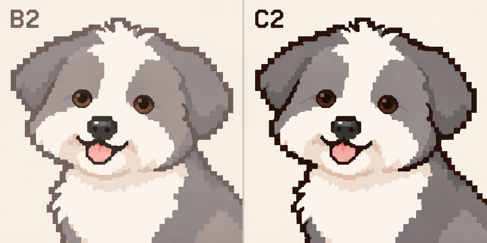

# 품종 머리 B2 화풍 정본 · 2026-11-06

사용자가 기존 시안으로 정본화하도록 지시했다. 직전 비교에서 기준으로 제시한 `B2 / SOFT PIXEL`의 표현을 현재 머리 화풍 정본으로 고정한다. [새 정본 manifest](../references/styles/breed-head-b2/v1/manifest.json) · [원본 그대로 보존한 이미지](../references/styles/breed-head-b2/v1/reference-sheet.png).

- 현재 style ID: `breed-head-soft-B2-v1`. SHA-256: `e15a82616528b4f05c51acc369ae4cbc25f6ffc781f1b1e11b1aea3f7fb1a3d6`.
- 공통 표현: 정본과 같은 픽셀 밀도, 털색과 어울리는 부드러운 윤곽, 둥근 검은 눈, 이어지는 넓은 색면과 완만한 음영 대비. 품종별로 별도 렌더 방식을 적용해 화풍이 달라지지 않게 한다.
- 형상은 최신 검토 모델에서 가져온다. 골든은 수정 adult-B를 작업 기준으로 삼으며 정본 속 과거 작은 머리 비율은 복사하지 않는다. 사진은 품종/개체 특징 참고다.
- 그림은 1536×1024 고해상도 화풍 참조이며 실제 64×64·5색·정수 격자 검증을 마친 자산이 아니다. 기존 native64 실행 목표와 1색 윤곽+내부4색 제작 목표는 유지하되, 코드 출력의 규격 PASS만으로 화풍 PASS를 대신하지 않는다.
- 새 후보는 같은 화면에서 다른 품종의 화풍과 대조한다. 굵고 거친 픽셀, 계단형으로 강하게 갈리는 그늘, 십자형 눈이 다시 나타나면 전달을 차단한다.
- 이전 C2는 역사적 비교 대안이며 현재 기본값이 아니다. 아래 v1 기록은 당시 정책/제작 수치의 이력이며 이번 선택과 충돌할 때 현재 절을 우선한다.

---

# B2·C2 비교 정본 화풍 규격 v1.0

## 2026-11-02 실행 경로 보완

[제작기 전환 로드맵](roadmap.md)에 따라 이 정본은 화풍 패키지 개발·검수 기준으로 보존한다. 아래 생성 입력 절의 실제 정본 이미지 필수 첨부는 이미지 모델을 사용하는 작업에 적용한다. 계획 중인 제작기 실행은 검수된 개체 구조·화풍/동작 패키지를 참조하도록 설계하며 매번 이 비교 시안을 입력으로 사용하지 않는다. 제작기·화풍 패키지 구현과 시각 검수는 아직 미완료다. B2/C2는 비교 정본이며 단일 제품 화풍은 미선택이다. 2026-11-03 결정으로 픽셀 원본 격자는 64×64px로 확정했다.

기준일: 2026-11-02. 사용자 지시: “b2를 정본으로 세부규격작성”, 이어 “c2도 함께 비교로 정본화하자.”

**B2와 C2는 각각 승인된 비교 기준이다. 제품에 적용할 단일 화풍은 아직 선택하지 않았다.** 정본화 범위는 표현 방식이며 참조 강아지의 외형·눈꺼풀·동작 승인이 아니다. 아래 수치는 후속 제작을 일관되게 하기 위한 v1 제작 기본값이며, 참조 이미지에서 실측한 값이나 실행 자산 검증 결과가 아니다.

## 1. 정본 파일과 적용 범위

- 보존 원본: [reference-sheet.png](../references/styles/b2-c2/v1/reference-sheet.png). 대화 생성 원본의 바이트를 그대로 보존했다. 크기 1774×887px, SHA-256 `654330121aa768fefddfbd0909e6975bb1b8bac539d533325364ba111cd8e744`.
- 기계 판독 기록: [manifest.json](../references/styles/b2-c2/v1/manifest.json). 출처는 대화에서 생성한 B2/C2 비교 이미지다. 실제 개체 사진이 아니다.
- B2: `nana-soft-B2-v1`, 규격 버전 `1.0.0`, 왼쪽 절반 x=[0,887), y=[0,887).
- C2: `nana-contrast-C2-v1`, 규격 버전 `1.0.0`, 오른쪽 절반 x=[887,1774), y=[0,887).
- 좌표는 원본의 반열린 범위다. 영역 내 문자·배경·중앙 구분선은 작화 참조에서 제외한다. 영역 지정은 참조 범위 기록이며 별도 크롭 파일을 제작했다는 뜻이 아니다.
- 과거 5안 중 ‘2번’ 눈꺼풀 시안과 이 B2/C2는 다른 참조다. ‘2번’의 선택 범위를 확대하지 않는다.
- 이 원본은 고해상도 시각 기준이다. 네이티브 픽셀 격자·단색 팔레트·레이어·프레임 규격을 충족하는 게임 실행 자산으로 등록하지 않는다.
- 정본 원본은 덮어쓰지 않는다. 변경 시 새 폴더·버전·해시와 선택 범위를 남긴다.

## 2. B2와 C2의 차이

| 항목 | B2: 부드러운 유색 윤곽 | C2: 짙은 대비 윤곽 |
| --- | --- | --- |
| 관찰되는 인상 | 외곽선이 털 색면과 부드럽게 이어짐 | 외곽선이 실루엣을 강하게 분리함 |
| 외곽선 색 역할 | 털색 계열의 어두운 회갈색·유색 그림자 | 흑갈색 또는 개체 색에 맞는 매우 어두운 유색선 |
| 윤곽 대비 | 눈·코가 외곽선보다 먼저 읽히도록 조정 | 외곽선과 눈·코가 모두 선명하게 읽히도록 조정 |
| 내부 경계 | 색면 경계로 우선 구분, 필요한 곳만 약한 선 | 색면 우선 원칙은 같고 필요한 겹침 경계의 대비를 강화 |
| 선 굵기 | 아래 공통 격자 기준 적용 | 같은 기준 적용. 대비를 높인다는 이유로 전신 테두리를 더 두껍게 만들지 않음 |
| 눈·코·입 | 어두운 핵심 형태, 작은 옅은 반짝임 | 같은 형태·반짝임 상한. 주변 경계의 대비만 해당 화풍에 맞춤 |
| 공통으로 생략 | 미세 잔털·수염·빽빽한 컬·광택·연속 명암 | 동일 |
| 비교 중 고정할 것 | 개체·외형·털 길이·포즈·캔버스·표시 크기·배경·색 배치 | 동일 |

C2를 단순히 B2의 선을 굵게 만든 그림으로 해석하지 않는다. B2도 윤곽을 흐리게 블러 처리하는 화풍이 아니다. 두 정본 모두 계단형 경계와 넓은 색면을 유지한다. 원본의 미세 색 차이는 시각 참조이며 모든 개의 털색을 회색으로 맞출 근거가 아니다.

## 3. 화풍 고정값과 개체별 값

| 공통 화풍이 정하는 것 | 개체 프로필이 정하는 것 |
| --- | --- |
| 선의 대비·색 역할·픽셀 경계 | 얼굴형, 머리/몸 비율, 귀 형태·길이·위치 |
| 큰 색면과 단계형 명암, 털 생략 방식 | 털색·큰 무늬·좌우 차이, 주둥이·코 형태 |
| 홍채/동공의 단순화와 반짝임 상한 | 눈 크기·간격·기울기·홍채색·노출·눈꺼풀 |
| 실루엣의 큰 털 덩어리 표현 | 부위별 털 길이·방향·눈 가림, 선택한 표현 길이 |
| 프레임 간 선·색·그림 덩어리의 일관성 | 몸통·다리·꼬리 비율, 관찰된 자세·행동과 습관 |

데포르메는 작은 크기에서 읽히도록 특징을 단순화하는 범위다. 모든 개에게 같은 둥근 얼굴, 짧은 귀, 큰 머리, 웃는 입, 갈색 눈을 부여하지 않는다. 머리/몸 비율의 공통 고정값은 두지 않는다. 표현상 비율 변경이 필요하면 해당 개체의 제작값과 검토 대상으로 기록한다. 눈꺼풀·털 가림의 미확인 부분은 화풍 참조로 채우지 않는다.

## 4. 격자·윤곽 제작 규격

아래 px는 **실제 제작 원본의 픽셀**이다. 현재 원본 격자는 [공통 설정](../config/project.json)의 `animation.resolution.selected_canvas_px`를 따른다. v1 정본 manifest의 `final_canvas_px: null`은 11월 2일에 보존한 화풍 참조의 이력이다.

| 항목 | v1 제작 기본값 | 적용·검증 경계 |
| --- | --- | --- |
| 작업 기준 격자 | 64×64px 픽셀 정본 | 1배와 최근접 정수 배율로 확인하고, 기기 표시 크기는 별도로 검수 |
| 외곽선 | 1px 기본, 모서리·부위 접합에 국소 2px 허용 | 전신을 2px 이상 띠로 감싸지 않음 |
| 내부선 | 1px 이하, 귀 겹침·입·발 분리 등 형태 해석에 필요한 곳만 | 털 한 올마다 선을 만들지 않음 |
| 윤곽 계단 | 연속된 덩어리와 의도된 계단형 연결 | 무작위 단일 픽셀 돌출·끊김·스프레이형 점 금지 |
| 알파 | 실행 PNG는 0 또는 255 | 반투명 가장자리·안티앨리어싱 금지 |
| 확대 | 정수 배율·최근접 이웃을 검수 기본값으로 사용 | 실제 앱 표시 크기에서도 별도 확인 |
| 팔레트 | 외곽과 겹침 윤곽에 같은 1색, 채움 최대 4색 | 투명 배경은 제외한다. 눈·코·무늬·음영과 부속품도 채움 4색을 공유한다. |

64×64는 96×96을 자동 축소해 통과시키지 않는다. 눈·무늬·귀·발이 남는지 다시 작화·검수한다. 96 기준의 2px 예외도 축소 결과에 그대로 승인하지 않는다. 고해상도 생성 시안에는 이 수치의 실제 준수를 선언하지 않고 실행용 재작화 단계에서 검사한다.

### 4.1 원본·비교판·앱에서 같은 픽셀 격자 유지

**작화 원본.** 캐릭터 한 프레임은 실제 64×64 격자에 그려 무손실 투명 PNG로 저장한다. 같은 장면의 캐릭터·타일·소품·픽셀 효과는 원본 한 칸의 크기를 공유한다. 새 자산을 넣을 때는 기존 자산 옆에 둘 다 1배로 배치해 윤곽 두께, 기준점, 접지선을 대조한다. 방향이 달라지면 해당 방향의 프레임을 준비하고 눈·귀·주둥이의 가림과 비대칭 무늬를 다시 확인한다.

**비교판.** 전신 1배와 필요한 부분의 확대를 함께 싣는다. 후보끼리 같은 영역과 배율을 쓰고 배율을 표시한다. 확대는 최근접 이웃으로 가로·세로에 같은 정수 배율을 적용한다. 예를 들어 6배 보기에서는 원본 한 칸이 단색 6×6 블록이어야 한다. 실사 사진은 별도 영역에 놓고 관찰에 맞춰 확대할 수 있다. 1배에서 눈매·귀·꼬리, 코·입·턱이 읽히는지는 확대 보기와 별도로 판정한다. 가려진 턱 관절은 추정 위치에 점이나 선을 추가해 설명하지 않는다.

**앱 표시.** 픽셀 장면을 한 번에 정수 배율로 확대한다. 스프라이트의 필터는 최근접 이웃으로 지정하고, 밉맵·손실 압축·가장자리 보간을 끈다. 카메라와 개체의 상대 위치는 화면에 그릴 때 정수 격자에 맞춘다. 이동 계산은 소수 좌표를 유지할 수 있다. 남는 화면 공간은 여백으로 두고 투명 오버레이에서는 그 투명성을 보존한다. 개별 스프라이트를 늘이거나 실행 중 임의 각도로 돌려 공간을 채우지 않는다. 픽셀 UI와 파티클도 같은 장면 격자에 맞춘다. 픽셀 글꼴은 설계 크기로 그린 뒤 장면과 함께 확대한다. 이 규칙은 운영체제의 일반 글자와 접근성 글자 크기에는 적용하지 않는다.

**통과 기준.** 원본의 크기·불투명 색 수·알파를 확인하고 확대 블록을 원본 픽셀과 대조한다. G0에서는 실제 기기의 물리 픽셀 기준으로 배율을 기록하고, 정지·이동·드래그 중 외곽의 한 칸이 흐려지거나 폭이 번갈아 바뀌는지 확인한다. 비교판 검수와 기기 검수 결과는 따로 기록한다.

## 5. 색면·명암·재질

- 각 털 색 영역은 기본색 1개와 음영색 1개를 기본으로 한다. 털 길이와 굴곡은 넓고 연결된 면으로 읽히게 한다.
- 실제 다른 털색·무늬는 별도 기본색 영역이다. 개체의 얼룩을 명암으로 오인해 지우거나 조명 그림자를 고정 무늬로 저장하지 않는다.
- 눈·코·입의 어두운 핵심색은 털 외곽선과 별도 역할이다. B2라고 검은 코와 동공까지 연하게 만들지 않는다.
- 털 명암은 귀 안쪽/겹침, 주둥이 아래, 목·가슴 접합, 다리 겹침 등 형태를 설명하는 큰 면에 제한한다.
- 자세마다 광원 방향을 정하고 같은 털색에서 빛이 덜 닿는 면을 한 단계 어둡게 그린다. 따로 움직이는 귀·다리·꼬리가 포개지는 구간에는 앞쪽 부위의 보이는 가장자리를 따라 외곽과 같은 색으로 1px 윤곽선을 그린다. 원본 1배에서 귀와 볼, 가슴과 앞다리, 골반과 뒷다리, 뒷다리와 꼬리를 각각 따라갈 수 있는지 확인한다.
- 털 내부의 작은 밝은 점·다단계 그라데이션·디더링·종이/크레용 노이즈·브러시 결·사진 질감은 사용하지 않는다.
- 코는 기본+음영, 작은 하이라이트 최대 1덩어리. 콧구멍과 입은 개체 형태를 단순화한 어두운 면으로 표현하며 코 중앙을 투명한 구멍처럼 만들지 않는다.
- 혀는 보이는 자세에만 기본+음영 2색 이내로 표현한다. 기준 이미지가 혀를 내밀었다고 모든 기본 자세에 혀를 붙이지 않는다.
- 목줄 등 부속품은 프로필 근거·표현 선택이 있을 때만 사용한다. 부속품도 같은 색 수·선 규칙을 적용한다.
- 배경 크림색은 비교용 배경이다. 개체 팔레트나 실행 PNG의 불투명 배경으로 편입하지 않는다.
- 두 안 비교 시 털·무늬의 기본색과 명암색을 먼저 맞추고 윤곽색 역할을 바꾼다. 추가 색 조정이 필요하면 비교 기록에 명시한다.

## 6. 털 생략과 실루엣

### 64×64에서 같은 칸을 두 특징이 필요로 할 때

1. 먼저 현재 자세와 얼굴 방향을 읽는 데 꼭 필요한 경계를 확보한다. 턱 사이의 틈, 지면과 발의 접점, 움직이는 귀와 볼의 경계가 예다.
2. 사진에서 확인한 개체의 식별점과 표정에 우선 배정한다. 그다음 해당 사진에도 보이는 품종 단서(귀의 처짐, 꼬리의 길이와 털 분포, 가슴 깊이 등)를 남긴다. 품종 설명만으로 가려진 부위를 추정해 추가하지 않는다.
3. 남길지 불분명한 요소는 그것을 뺀 1배 전신과 비교한다. 개체·품종·자세를 읽는 데 도움이 없거나 더 중요한 경계를 흐리면 생략한다. 골든 측면에서는 독립 혀색을 생략하되 열린 입은 보존한다. 다른 개체나 자세에서는 혀 자체가 식별점이면 다시 판단한다.

털의 정보 우선순위는 **큰 색 배치 → 부위 실루엣·길이 → 겹침 → 최소한의 내부 털 덩어리**다. 세부 결을 추가해 닮음을 보완하기 전에 귀 길이·주둥이·눈 간격·무늬 위치가 맞는지 확인한다.

| 부위 | 표현 규칙 | 이전 96 격자에서 사용한 참고 예산 |
| --- | --- | --- |
| 정수리·볼 | 털 방향을 읽을 수 있는 큰 끝부분만 남김 | 각 영역의 주된 갈래 2–4개 |
| 귀 | 귀 전체의 길이·폭·끝 모양 우선, 내부는 넓은 명암 | 귀당 내부 음영 덩어리 1–2개 |
| 가슴·몸통 | 가슴 털 실루엣과 몸 덩어리 분리 | 부위당 주된 털 갈래 2–4개, 반복 컬 없음 |
| 다리·발 | 발 접지와 다리 길이가 먼저 읽히도록 | 발 가장자리의 장식 털은 최소화 |
| 꼬리 | 방향·길이·말림·털 부피 보존 | 큰 덩어리로 단순화, 개별 털선 없음 |

이 예산은 시각 밀도를 제어하는 제작 시작값이다. 단모 개에게 개수만 채우기 위해 갈래를 추가하지 않는다. 개체 식별에 필요한 큰 털 묶음·무늬를 예산에 맞춰 삭제하지 않으며 초과 시 해당 영역과 이유를 남긴다. 곱슬털도 수십 개의 작은 고리 대신 큰 굴곡과 실루엣으로 표현한다. 개별 수염선과 털 끝 점묘는 생략한다.

## 7. 눈·눈꺼풀·얼굴 레이어

눈 크기와 시선은 개체 사진에서 정한다. 나나는 먼저 둥근 눈의 위치와 범위를 고정한다. 작은 동공과 반사점은 그 안에서만 이동하며 눈 경계나 앞머리에 가려진 부분은 잘라낸다. 홍채는 별도로 묘사하지 않는다. 좌우 시선을 바꿔도 바깥 눈매와 주변 털의 픽셀이 그대로인지, 양눈의 흰자 노출 차이가 원본 1배에서 읽히는지 확인한다.

나나의 중립 시선에는 흰자를 그리지 않는다. 고개만 옆으로 돌려도 이 기준은 같다. 곁눈질할 때만 동공 이동 반대편에 흰자가 일부 보이게 한다. 64×64에서는 각 행에 최대 한 칸으로 제한하고, 눈꺼풀이나 털에 가리면 생략한다. 동공 안의 작은 반사점은 흰자와 따로 검수한다.

각 시점에서 먼저 실제로 보이는 눈을 정한다. 나나의 사진 3을 기준으로 한 사선에서는 가까운 눈 하나만 그리고 먼쪽 눈은 털 뒤에 가린다. 귀의 붙은 윗부분은 머리에 자연스럽게 이어지게 하고 볼에 포개진 귀 앞쪽에만 경계를 둔다. 턱이 가슴털 앞에 있는 구간은 보이는 턱 아래 윤곽을 따라 짧게 구분한다. 가려진 관절은 표시하지 않는다.

- 다른 개체에서 홍채색이 중요한 식별 특징이면 내부 4색 안에서 표현한다.
- 반짝임: 눈당 최대 1개 덩어리. 96 기준 1px부터 시작하며 필요한 경우에만 2px 연결 덩어리. 순백색 별·여러 점·외곽 발광은 금지하고 옅은 유색 밝은색을 사용한다. 눈 크기와 표시성에 따라 생략 가능하다.
- 홍채/동공이 보이는 경계는 눈꺼풀과 털의 가림으로 결정한다. 가려진 전체 눈 모양을 추정 사실로 저장하지 않는다.
- 윗눈꺼풀, 눈 주변 털, 눈썹처럼 보이는 임의 선을 구분한다. 털선이 화난 표정·슬픈 표정으로 읽히면 위치·방향·가림을 수정한다.
- B2/C2의 눈 크기·갈색 홍채·눈꺼풀 형태는 공통 고정값이 아니다. 두 안 비교에서는 해당 개체의 눈 형태와 가림을 동일하게 유지한다.
- 기본 입 모양과 혀 노출은 개체·자세에 따른다. 미소나 헥헥거림을 화풍 요소로 상시 적용하지 않는다.

제작 원본은 최소한 다음 의미 단위를 분리한다. 실제 파일 형식·엔진 구현은 후속 결정이다.

1. 뒤쪽 몸/귀/꼬리
2. 얼굴·몸 기본 털색과 큰 무늬
3. 안구/홍채/동공/반짝임
4. 눈꺼풀·눈 노출 마스크
5. 안구를 가리는 앞쪽 털
6. 주둥이/코/입/턱/혀 및 해당 가림

이는 모든 포즈의 고정 z-order가 아니다. 방향·고개 회전·깜박임에 맞는 `pose_layer_order`와 `clip_masks`를 기록한다. 눈이 털 위에 스티커처럼 얹히지 않게 하고, 깜박임은 눈꺼풀/노출 마스크가 담당하며 이마 털 전체를 눌러 표정을 만들지 않는다. 주둥이에 가려지는 혀 등도 별도 가림을 확인한다.

## 8. 전신·동작으로 확장할 때

정본이 보여주는 범위는 정면에 가까운 상반신이다. 뒷모습·전신 비율·걷기·앉기·잠든 자세의 모양은 이 이미지로 확정하지 않는다. 해당 개체 사진·승인된 외형 자산·포즈 근거와 프로필을 사용한다.

- 정적 개체 기준 자산을 먼저 검수한 뒤 같은 dog_id·profile_revision·style_policy_id/version으로 동작을 확장한다.
- 팔레트, 윤곽색 역할, 큰 무늬의 부위상 위치, 귀·꼬리·다리 구조를 프레임 간 유지한다.
- 같은 포즈가 유지되는 구간에서 윤곽 두께·털 갈래·눈 하이라이트가 무작위로 변하지 않는다. 시선 변화·가림에 필요한 변화만 허용한다.
- 캔버스·기준점·접지선은 자산 묶음 안에서 일관되게 관리한다. 움직이는 부위를 화면 좌표에 고정하는 것과 혼동하지 않는다.
- 좌우 비대칭은 개체의 좌우로 관리한다. 반대 방향을 무조건 좌우 반전해 만들지 않는다.
- 기본 재생은 8fps·125ms다. 프레임 수·정지 유지 시간·이동 시간은 별도다.
- 걷기·쉬기·잠든 자세와 얼굴 가림이 변하는 고개 돌림·깜박임을 검수한다. 정지 이미지가 있다는 사실을 동작 지원 완료로 처리하지 않는다.
- 기존 얼굴·상황별 움직임 정책의 제어·충돌·복귀 규칙은 유지한다. 과거 P1의 크레용 질감·점눈·약한 필압은 그 후보의 기록이며 B2/C2 작화에 적용하지 않는다.

### 8.1 구도별로 보여야 하는 신체 구조

모든 개체에서 먼저 자세, 몸이 향한 방향, 얼굴이 향한 방향을 정한다. 발과 꼬리의 가림은 몸 방향을, 눈·귀·코·주둥이의 가림은 얼굴 방향을 따른다. 예를 들어 몸은 완전 측면으로 앉고 고개만 관객 쪽으로 돌리면 발은 측면 규칙, 얼굴은 앞쪽 ¾ 규칙을 쓴다. 가까운 쪽과 먼 쪽은 카메라 기준이다.

아래는 개의 눈높이에서 전신을 본 기본 앉기 구도다. 앞쪽 ¾와 완전 측면의 발 수, 완전 측면의 꼬리 노출은 사용자가 지정했다. 다른 방향은 제작 기본안이다. 서기·걷기·엎드리기에는 해당 자세에서 체중을 받는 다리와 접지 상태를 따로 정한다.

| 앉은 구도 | 코·주둥이·입·턱 / 눈·귀 | 목·가슴·등·골반 | 앞다리·앞발 | 접힌 뒷다리·뒷발 | 꼬리 |
|---|---|---|---|---|---|
| 정면 | 양눈 사이 아래에 코, 그 아래에 주둥이와 턱. 양쪽 귀의 자리 | 턱 아래에 가슴 중앙, 양옆으로 어깨와 허벅지 | 가슴 양옆에서 내려오는 두 발이 각각 접지 | 허벅지는 양옆에서 읽힌다. 뒷발은 앞발 뒤에 숨을 수 있다 | 엉덩이 뒤로 가려도 된다 |
| 앞쪽 ¾ | 양눈과 양쪽 귀의 자리. 먼 볼은 좁아지고 코는 얼굴이 향한 쪽으로 치우친다 | 턱 아래 가슴과 가까운 옆구리가 함께 보이고 등선이 엉덩이로 이어진다 | **두 앞발**의 발끝과 바닥에 닿는 면을 구별한다 | 가까운 허벅지가 접히고 그 끝에서 **뒷발 하나**가 보인다. 먼 뒷발은 가린다 | 옆으로 나오면 엉덩이에서 이어지고, 뒤에 놓이면 가려도 된다 |
| 완전 측면 | 코끝→주둥이→턱의 옆 윤곽, 가까운 눈·귀 하나. 먼 귀 끝은 겹쳐 보일 수 있다 | 목 앞선은 가슴으로, 목 뒷선은 등과 엉덩이로 이어진다 | 가까운 **앞발 하나**가 어깨 아래에 접지. 먼 앞발은 겹친다 | 접힌 허벅지 아래 **뒷발 하나**가 앞발과 구별된다. 먼 뒷발은 겹친다 | **필수**. 엉덩이에서 이어지는 방향과 끝이 읽힌다. 짧거나 말린 꼬리는 개체 형태를 따른다 |
| 뒤쪽 ¾ | 가까운 귀와 뒤통수 위주. 가까운 눈이나 코끝은 머리 윤곽 밖으로 실제 드러날 때만 표시 | 등과 가까운 엉덩이가 중심이고 가슴은 대부분 가려진다 | 가까운 앞발이 옆구리 앞에 드러날 수 있다. 먼 앞발은 가려진다 | 가까운 허벅지의 접힌 방향을 보인다. 뒷발 끝은 그 아래에서 드러날 수 있다 | 엉덩이 뒤에서 나와 옆으로 향하거나 몸에 겹치는 흐름이 읽힌다 |
| 완전 후면 | 뒤통수와 양쪽 귀 뒷면. 시선이 몸과 같으면 눈·코·입은 가려진다 | 뒷목→등 중앙→골반, 바닥에 닿는 양쪽 엉덩이 | 몸 앞에 가려도 된다 | 양쪽 접힌 허벅지가 몸을 받친다. 뒷발 끝은 자세에 따라 가려진다 | 골반 뒤에서 시작해 내려가거나 말리는 방향이 읽힌다. 몸에 겹친 구간은 일부 생략할 수 있다 |

**원본에서 판독하는 법**

- 앞쪽 ¾ 앉기에서 어깨 아래 두 앞다리는 가슴을 받치며 내려온다. 배는 접힌 허벅지 앞에서 바닥을 벗어나고, 가까운 뒷발은 허벅지 밑에서 앞으로 향한다. 발끝 사이 여백과 앞뒤 발의 높이 차는 시점·다리 길이·털 길이에 맞춘다.
- 발은 다리에서 이어지는 발끝과 바닥에 닿는 면으로 센다. 둥근 허벅지만 보이거나 몸통 밑에 밝은 점 하나가 있는 상태는 뒷발 하나로 세지 않는다. 같은 털색끼리 붙어도 윤곽의 꺾임이나 이어진 그늘로 발끝이 구별되면 된다.
- 머리는 코끝에서 콧등·이마로, 주둥이 아래에서 턱·목·가슴으로 이어져야 한다. 닫힌 입은 짧은 선이나 주둥이 아랫면으로 충분하다. 장모가 눈이나 관절을 덮으면 실제로 보이는 털 경계와 실루엣을 사용한다.
- 꼬리는 골반 뒤에서 시작한다. 뿌리가 털에 덮여도 보이는 부분을 엉덩이 쪽으로 따라갈 수 있어야 한다. 확인된 개체 특성상 기본 구도를 만족시키기 어려우면 예외와 관찰 근거를 기록한다.
- 64×64 최종 합성본을 1배로 보고 정해진 발 수와 가림을 판독한 뒤, 96×96 전달본에서도 같은 위치를 다시 확인한다. 프로필에 부위 이름이 있거나 확대해서 픽셀이 보이는 것만으로 통과시키지 않는다.

## 9. 생성 입력과 비교 절차

[화풍 참조 분리 정책](style-reference-policy.md)과 [프로필 생성 설계](profile-generation-spec.md)를 함께 적용한다.

매 작업은 style ID/version, 정본 파일 SHA-256, 사용 영역, 실제 참조 순서, dog_id와 고정된 프로필 revision, 허용 변경 범위, 요청한 동작, 출력 종류를 기록한다. 참조 이미지와 프로필 버전이 빠진 작업은 정본 재현 작업으로 진행하지 않는다. 개체와 무관한 순수 화풍 연구는 `style_study`로 구분한다.

생성 요청의 공통 틀:

> 첨부 정본 비교표의 지정 영역만 화풍으로 참조한다. B2는 왼쪽, C2는 오른쪽이며 이번 작업은 [style ID]이다. 글자·배경·다른 절반은 참조하지 않는다. 다른 개체 사진은 대상 강아지의 형태와 무늬에만 사용한다. 정본 캐릭터의 얼굴형·눈꺼풀·귀·회백색 무늬를 이식하지 않는다. 넓은 색면, 털 영역별 기본색+음영 1단계, 적은 내부선, 큰 털 덩어리와 계단형 윤곽을 유지한다. [B2의 부드러운 유색 윤곽 / C2의 짙은 유색 윤곽]을 적용한다. 개별 털·수염선·반복 컬·노이즈·그라데이션·강한 반짝임은 생략한다. 개체의 눈·눈꺼풀·털 가림과 비율은 제공된 개체 기준을 따른다. 출력은 [고해상도 검토 시안 / 실제 격자를 검사할 실행 자산 후보]이다.

후속 B2/C2 비교는 같은 사진·프로필·털 길이·구도·배경·눈 형태·표시 크기를 사용한다. 먼저 정면 얼굴과 동일 자세 전신을 비교하고, 그 뒤 같은 동작·프레임 시간으로 비교한다. 화풍 외에 달라진 항목과 생성 편차는 별도로 기록한다.

사용자가 fresh run을 요청한 비교는 독립 실행으로 만들고 각 실행에 정본 원본을 직접 전달한다. 과거 실패한 생성 결과를 정본 대신 주지 않는다. 에이전트 모델과 이미지 생성 도구의 내부 모델·seed는 구분해서 기록한다.

## 10. 검수와 통과 기준

| ID | 확인 내용 | 실패 예 |
| --- | --- | --- |
| S01 정본 연결 | 파일 해시·영역·style ID가 일치하고 실제 도구에 이미지가 전달됨 | 텍스트만 “B2풍”, 양쪽 화풍 혼입 |
| S02 윤곽 | B2/C2 지정 대비와 공통 선 규칙 유지 | B2를 짙은 C2 테두리로 생성, C2를 두꺼운 스티커 띠로 생성 |
| S03 면·밀도 | 넓은 색면·제한된 명암, 큰 털 덩어리 | 빽빽한 컬·수염·잘게 갈라진 음영·사진 질감 |
| S04 눈 | 개체 눈매/가림 보존, 홍채/동공과 옅은 반짝임 규칙 | 공통 눈꺼풀 복제, 털 위에 붙은 눈, 반짝임 여러 개 |
| I01 개체 | 귀·주둥이·눈 간격·비율·큰 무늬·좌우 차이 보존 | 정본 강아지의 회백색 얼굴·귀 이식 |
| F01 형식 | 시안/실행 자산 분류, 요청 구도·전신 포함·배경 충족 | 상반신만 있는 결과를 전신 완료로 처리 |
| P01 픽셀 | 실행 자산의 실제 크기·팔레트·알파·계단형 경계 검사 | 축소 미리보기만 확인하고 실제 64×64 원본을 통과 처리 |
| M01 연속성 | 지정 포즈·프레임에서 무늬·선·색·가림·접지 유지 | 털 갈래 깜박임, 발 미끄러짐, 눈꺼풀 뒤집힘 |

개체 유지·화풍 유지·형식·실행 격자·동작을 각각 `pass / partial / fail / unreviewed / not_applicable`로 기록한다. 정적 시안에 동작 검수는 not_applicable이지만 후속 동작 지원 승인을 뜻하지 않는다. 필수 항목의 partial/fail/unreviewed가 남으면 해당 범위는 승인하지 않는다. 실제 관찰로 확인한 닮음과 제작자의 스타일 평가는 보호자의 외형 수락과 별도로 기록한다.

고해상도 비교는 원본에서 두 참조의 같은 부위를 나란히 확인한다. 실행 자산은 원본 1배·최근접 확대·목표 표시 크기에서 검사한다. 8fps 재생은 별도 검사하며, 문서화와 프롬프트 준수만으로 시각 통과를 주장하지 않는다.

## 11. 버전과 현재 완료 범위

- 완료: B2/C2 비교 정본 지정, 원본·적용 영역·해시 보존, 공통/차이 규격과 검수 기준 작성.
- v1 수치: 제작 기본값이다. 실제 개체·격자에서 조정이 필요하면 근거·영향 범위와 새 규격 버전을 기록한다.
- 미완료: 두 정본을 적용한 새 개체 시안의 승인, 최종 단일 화풍, 기기 표시 크기, 실행 팔레트·레이어·동작 자산 검증, 앱/생성 파이프라인 구현.
- 과거 B2 실험의 미충족 결과는 여전히 미충족이다. 이번 정본화로 이전 결과를 소급 승인하지 않는다.
- B2와 C2 중 하나로 변경해도 개체 관찰·행동 프로필은 보존한다. 표현/자산 버전을 새로 만들고 영향받는 자산을 재검수한 뒤 사용 묶음을 전환한다.
