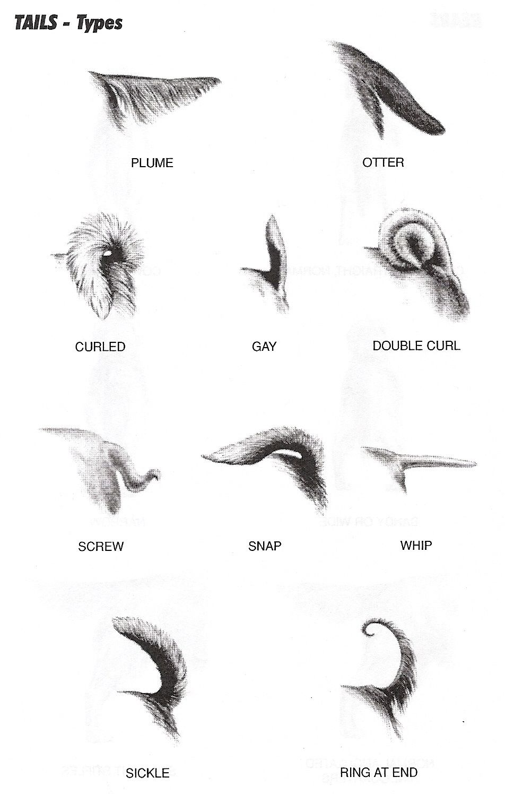

# 화풍 참조와 개체 참조 분리 정책

## 픽셀 작화의 색과 전신 구조

새 정본과 해상도 비교본 모두 외곽선은 전신에 한 색만 사용하고 내부는 최대 네 색을 공유한다. 자세별 광원과 부위의 앞뒤 관계를 정한 뒤 빛이 덜 닿는 귀 안쪽·턱 아래·배 밑·다리 사이를 어둡게 그린다. 흰 가슴과 발목처럼 개체를 알아보게 하는 무늬는 조명과 별도로 기록한다.

원본 1배에서 사진에 보이는 귀와 볼, 턱과 가슴, 어깨와 앞다리, 골반과 뒷다리, 발과 꼬리를 따라가 본다. 귀·다리·꼬리처럼 따로 움직이는 부위가 다른 부위 앞에 포개지면 보이는 겹침 경계에 전신 외곽과 같은 색으로 짧은 선을 그린다. 선은 겹침이 끝나는 곳에서 멈추고, 이어지는 근육의 굴곡은 광원에 따른 음영으로 표현한다. 사진에서 가려진 부위는 미확인으로 남긴다. 나나의 눈동자는 홍채 없이 작고 둥글게 그리며 눈매는 흰자의 노출과 앞머리로 표현한다.

## 2026-11-02 제작기 전환 로드맵과 참조 적용 범위

[현재 로드맵](roadmap.md)은 프로필·제작 패키지 기반의 재현 가능한 출력 경로를 먼저 검증하는 계획이다. 아직 구현되거나 검수된 제작기는 없다.

- 이미지 생성 도구를 사용하는 탐색·부품 개발·기존 화풍 재현 실험은 실제 정본 이미지를 전달하는 규칙을 계속 적용한다.
- 계획 중인 제작기 실행은 개체 프로필 revision, 검수된 개체 제작 구조와 부품/마스크, 화풍·동작 패키지와 렌더러 버전을 입력으로 사용한다. 매번 정본·사진·이전 생성 시안을 첨부하는 방식으로 구현하지 않는다.
- 정본 이미지는 화풍 패키지 개발과 시각 회귀 검수의 근거로 보존한다. 실행 시 참조 이미지를 빼도 되는지는 사진/정본 접근 없는 재출력·동일 픽셀 결과·개체 닮음·정본 일치 검증으로 판단한다.
- 부품·마스크 같은 실행 자산은 계속 필요하다. 기준 “자산”을 임시 PNG 시안으로 한정하지 않는다. 동작 확장에는 해당 개체의 승인 범위 안에서 검수한 제작 구조가 필요하다.
- 아래의 “실제 이미지 필수 전달”은 image_gen 등 이미지 모델 경로에 적용한다. 제작기 목표가 현재 이미지 생성 실험의 참조 생략이나 자동 승인 근거가 되지 않는다.

기준일: 2026-11-02. 상태: 제작 정책 보완. 자동 검사·생성 시스템 구현 완료를 뜻하지 않는다.
[개체 프로필 생성 설계](profile-generation-spec.md)와 [자산 규격](asset-spec.md)을 함께 적용한다.

## 1. 입력마다 역할을 지정한다

| 역할 | 사용할 정보 | 가져오지 않을 정보 |
| --- | --- | --- |
| identity_photo | 개체 체형·비율·귀·눈·주둥이·색·무늬, 직접 보이는 자세 | 사진의 잔털·광택·조명·배경을 그대로 작화 규칙으로 복제하지 않음 |
| style_reference | 윤곽 굵기·색, 픽셀 덩어리 크기, 큰 색면, 명암 단계, 생략 수준 | 참고 캐릭터의 얼굴형·눈매·눈꺼풀·귀·무늬·체형을 새 개체에 이식하지 않음 |
| approved_identity_asset | 해당 개체·프로필 버전에서 검수된 외형 표현과 지원 방향 | 승인 범위 밖 자세·동작·실제 개체 사실 |
| pose_reference | 요청한 자세·접지·관절 배치 | 다른 개체의 외형과 무늬 |

파일 ID·버전·해시, 실제 전달 순서, 사용 영역과 역할을 reference manifest에 기록한다. 비교표 전체를 사용하면 “왼쪽 B2만 화풍 참조, 오른쪽 C2 제외”처럼 적용 영역을 명시한다. 제외 영역이 섞였으면 화풍 검사에서 실패 처리한다. 개인 원본·개체 프로필은 공개 Git에 넣지 않는다.

정해진 화풍으로 제작할 때는 텍스트 설명만으로 이미지 참조를 대체하지 않는다. 실제 image_gen 요청의 referenced_image_paths에 동일한 화풍 파일이 들어갔는지 호출 전에 확인한다. 화풍 이미지가 없다면 기존 화풍 준수 작업을 실행한 것으로 보고하지 않고, 새 화풍 탐색임을 구분한다.

## 2. 화풍은 구체적인 표현 규칙으로 작성한다

매 작업의 style contract에 다음을 기록한다.

- 픽셀 격자 목표와 결과물 종류: 고해상도 비교 시안 / 실제 저해상도 실행 자산.
- 윤곽: 기준 이미지의 굵기, 유색 외곽선의 대비, 내부선 생략 범위.
- 색면·명암: 기본색과 허용 음영 단계, 재질별 팔레트 목표.
- 털: 실루엣과 몇 개의 큰 덩어리로 길이감을 표현. 사진의 개별 털·컬·점무늬를 빽빽하게 재현하지 않음.
- 눈·코: 개체의 형태를 유지하면서 반짝임·명암 표현만 화풍 규칙에 맞춤. 임의의 눈꺼풀 모양이나 홍채색은 공통 규칙이 아님.
- 금지 표현: 사진 질감, 연속 그라데이션, 미세 잔털·수염선, 광택 렌더링, 잘게 쪼개진 내부 명암 등 해당 화풍과 충돌하는 요소.

숫자 목표는 제작 제약이며 생성 결과에서 실측했다고 주장하지 않는다. 픽셀 정본은 실제 64×64px 원본이다. 고해상도 그림의 64px 축소 미리보기는 시각 비교에 사용한다. 픽셀 격자·색 수의 정확한 준수가 필요하면 원본 파일 규격과 사용 색을 별도 검증하고, 시각적 유사성만으로 실행 자산 통과를 선언하지 않는다.

화풍의 단순화와 개체 특징이 충돌하면 윤곽·큰 무늬·비율 등 식별단서를 우선 유지하며 작은 질감부터 생략한다. 필요한 경우 해당 특징만 국소 조정하고 보호자 검토 대상으로 남긴다. 사진과 다른 머리 비율이나 무늬를 “화풍”이라는 이유로 확정하지 않는다.

## 3. 생성 전 검사

### Codixel을 참고한 픽셀 묘사

머리부터 발끝과 꼬리까지, 사진에서 알아볼 수 있어야 할 형태를 적고 선택한 B2 또는 C2 정본의 색면과 윤곽을 대조한다. Codixel에서는 적은 픽셀로 형태를 살리고 그림 안의 색으로 윤곽을 잡는 방법을 참고한다. 원문에는 경계 디더링 예시도 있다. B2·C2에서는 털과 털이 겹치는 경계를 포함해 털 묘사에 디더링을 쓰지 않는다. 가슴털과 앞다리처럼 비슷한 색이 맞닿으면 넓은 음영면으로 구분하고, 겹침이 읽히지 않는 곳에만 짧은 선을 쓴다. [B2·C2 색면 기준](b2-c2-style-spec.md) · [Codixel 원문과 그림 예시](https://github.com/mankidev/codixel/blob/604a9dcbcc4e386bc48188b5f7f49099f5d04db7/README.md)

전신 비교에는 같은 자세와 방향에서 양쪽 모두 보이는 두 기준점을 고른다. 예를 들어 옆으로 선 개라면 어깨와 엉덩이 사이를 쓸 수 있다. 후보는 원본 1배로 두고, 사진의 두 점 사이 거리가 후보의 기준 길이와 같아지도록 사진 보기만 가로세로 같은 비율로 확대·축소한다. 두 이미지에서 같은 발의 접지점이 보이면 그 점을 맞춘다. 비교 기록에는 사진 ID, 원본 픽셀 기준 자른 영역(x, y, 폭, 높이), 두 기준점의 좌표와 목표 길이(px), 정렬에 쓴 위치를 남긴다. 기준으로 맞춘 길이는 독립적으로 검증한 항목에서 제외한다.

이 전신 보기에서 머리와 몸통의 상대 크기, 다리의 드러난 길이, 꼬리 방향을 대조한다. 모든 후보의 원본 1배 보기는 별도로 보존한다. 얼굴은 머리 폭을 맞춘 확대 보기를 추가할 수 있다. 자세나 방향이 달라 직접 대조하기 어렵거나 부위가 가려졌으면, 관찰 가능한 부분만 비교하고 나머지는 미검수로 기록한다.

### 입력 확인

**사진에서 무엇을 남길지 고른다.** 8bit-pixel-art의 사진 분석법을 참고해 큰 형태와 상대 크기, 기울기, 겹침, 좌우 차이를 먼저 짚는다. 아래 항목 중 사진과 프로필에서 확인되는 특징을 묘사에 쓴다. 가려진 발이나 꼬리, 반대쪽 무늬는 미확인으로 기록한다. 색과 외곽선은 선택한 B2 또는 C2 규격을 따른다. [8bit-pixel-art의 사진 분석 절차](https://github.com/TwentyfiveBTea/8bit-pixel-art/blob/59de3115be1f87ed68446f73685b28ad493169dd/SKILL.md#deconstruct-before-drawing)

| 부위 | 사진과 전신 시안에서 대조할 특징 |
| --- | --- |
| 머리·목·어깨 | 머리 폭과 가슴 폭의 관계, 귀와 볼의 겹침, 목털이 어깨를 덮는 위치 |
| 가슴·몸통·골반 | 가슴 깊이, 등과 배의 윤곽, 어깨에서 엉덩이까지의 길이, 몸통 좌우의 큰 무늬 |
| 앞다리·뒷다리·발 | 몸통에 가려지는 길이, 앞뒤 다리의 겹침, 자세에 따라 바닥에 닿거나 들린 발 |
| 꼬리 | 몸통에서 시작하는 위치, 길이와 말리는 방향, 몸통과 겹칠 때 보이는 꼬리 끝 |

**수정 의견은 전신 비교에서 해당 부위에 연결한다.** Image Cockpit의 영역 번호 방식을 참고해 바꿀 점과 유지할 특징을 함께 적는다. 예를 들어 “① 가슴·앞다리 — 가슴털에 묻힌 앞다리의 시작점을 사진과 대조한다. 발의 접지 위치는 유지한다.” “② 골반·꼬리 — 엉덩이와 겹치는 꼬리 끝이 원본 1배에서 읽히도록 색면을 나눈다. 꼬리가 말리는 방향과 옆구리 무늬는 유지한다.” 수정 후 전신을 다시 보고 지정 영역 밖의 체형과 무늬를 대조한다. [Image Cockpit의 Image Editing 예시](https://github.com/dreiachse-cyber/image-cockpit-for-codex-workflows/blob/d837e0d8a4a69ed372256b2a2065594312c9cf1e/README.md)

동작 시안에서는 큰 무늬가 같은 신체 부위에 남는지 먼저 확인한다. 발 미끄러짐은 접지 구간(`contact_frames`)에 지면을 짚는 같은 발(`contacting_feet`)을 추적해 판정한다. 각 프레임에서 기준점(`anchor_px`)을 기준으로 잰 발 위치에 캐릭터의 누적 이동량(`movement`)을 더해 지면 기준 위치를 비교한다. 몸이 오른쪽으로 2px 이동하고 딛는 발이 기준점에 대해 왼쪽으로 2px 옮겨졌다면 지면에서 그 발은 제자리에 있다. 이동량이나 접지 구간·해당 발을 확인할 수 없으면 미끄러짐은 미검수로 남긴다. [동작 자산 규격](asset-spec.md)

### 꼬리 형태 참고 도표

2026-11-03 사용자 제공 자료 *TAILS - Types*. 아래 이름은 그림에 적힌 표기를 그대로 옮겼다. 설명은 그림에서 대조할 시각적 특징이다.

| 도표 표기 | 그림에서 볼 부분 |
| --- | --- |
| PLUME | 꼬리 아래로 길게 늘어져 부채처럼 퍼지는 털 |
| OTTER | 굵은 시작 부분에서 끝으로 갈수록 좁아지는 윤곽 |
| CURLED | 몸 위로 휘어 되돌아오는 꼬리의 방향 |
| GAY | 위로 세워 든 꼬리의 자세 |
| DOUBLE CURL | 둥글게 여러 겹으로 말린 윤곽 |
| SCREW | 짧은 구간에서 방향이 꺾이고 꼬이는 모습 |
| SNAP | 등 위로 접혀 누운 꼬리의 방향 |
| WHIP | 몸에서 가늘고 길게 뻗는 윤곽 |
| SICKLE | 낫처럼 넓은 호를 그리며 올라가는 윤곽 |
| RING AT END | 끝부분에 국소적으로 생기는 고리 |

개체 사진에서는 **꼬리 자체의 선과 길이**, **털이 더하는 폭**, **해당 자세에서 꼬리를 든 방향**, **몸이나 뒷다리에 가려진 부분**을 따로 기록한다. 도표에는 털 모양과 자세가 함께 제시되어 있으므로 개체마다 한 유형을 고를 필요는 없다. 옆모습에서 꼬리가 넓어 보이면 먼저 뒷다리와 겹친 경계와 늘어진 털을 확인한다. 끝이 가려졌다면 굵기나 말림은 미확인으로 두고, 확인된 범위에서만 실루엣을 단순화한다.

나나의 보조 사진에서는 어두운 꼬리털이 뒷다리 옆으로 내려온다. 같은 자세에서 뿌리부터 끝까지 드러나는 자료가 부족하므로 유형과 끝의 폭은 미확인이다. 이 도표는 형태를 비교하는 참고 자료이며, 나나를 가늘고 뾰족한 꼬리로 다시 그릴 근거로 쓰지 않는다.

### 생성 직전 확인 사항

1. 신규 개체 ID와 프로필/제작 설정을 확인한다. 화풍 참조의 개체를 새 사진의 개체로 오인하지 않는다.
2. identity_photo와 style_reference의 실제 파일을 보고 각각의 역할·적용 영역을 확인한다.
3. 생성 도구에 제공할 파일 순서와 프롬프트의 이미지 번호가 일치하는지 확인한다.
4. “같은 개를 이 화풍으로”만 쓰지 말고 역할·단순화·금지 요소를 명시한다.
5. 새 작업에서 이전 실패 이미지를 기준 자산으로 재사용하지 않는다. 기존 기준과 실패 결과의 역할을 분리한다.

사진별 관찰값을 늘리는 것만으로 화풍 통제가 강화되지는 않는다. 정책 적용안에는 개체 프로필을 추가하되 화풍 참조와 공통 출력 조건은 비교안과 동일하게 유지한다.

## 4. 결과를 두 축으로 검사한다

| 검사 | 확인 항목 |
| --- | --- |
| 개체 유지 | 사진의 귀·눈·주둥이·몸 비율·큰 색 배치, 알려진 좌우 차이, 다른 개체 특징의 혼입 |
| 화풍 유지 | 제공한 화풍 이미지와 윤곽·큰 색면·음영 단계·털 생략·픽셀 덩어리가 실제로 유사한지 |
| 형식 | 요청한 구도·배경·전신 포함 여부, 시안/실행 자산 구분 |
| 기록 | 실제 참조 파일·요청문·프로필·도구 호출 횟수와 결과 파일 연결 |

정책을 프롬프트에 넣었다는 사실은 결과의 정책 준수 증거가 아니다. 닮음과 화풍을 각각 통과·부분 충족·미충족·미검수로 기록한다. 이미지를 부모 에이전트 또는 제작자가 직접 확인하며 모델의 자기평가만으로 통과시키지 않는다.

털·명암이 지나치게 세밀하면 “픽셀 윤곽이 있으므로 준수”라고 보고하지 않는다. 실제 결과의 한계를 명시하고, 보완 제작 시 실패 원인과 변경한 조건을 남긴다.

## 5. 독립 비교 실행 규칙

- 사용자가 fresh run을 요청하면 대화 이력 없는 작업으로 분리하고 다른 결과를 보지 않게 한다.
- 비교하는 모든 작업에 동일한 사진과 동일한 실제 화풍 이미지, 적용 영역·순서·공통 출력 규칙을 제공한다.
- 정책 적용안만 추가 프로필·근거·유지 제약을 사용한다. 일반안은 공통 화풍·사진 입력만 사용한다.
- 같은 일반 조건의 반복은 요청문까지 동일하게 유지한다. 각각의 첫 결과를 보존하고 재생성·선별 여부를 공개한다.
- 새 실험은 이전 결과를 덮어쓰지 않고 별도 실행 ID로 기록한다. 재시도는 수정된 조건의 새 실험이며 첫 실험의 무수정 결과와 구분한다.
- Sol 등 작업 에이전트 모델/추론 설정과 image_gen 내부 이미지 모델을 구분한다. 이미지 모델이나 seed를 지정하지 않았다면 고정했다고 보고하지 않는다.
- 한두 번의 시안으로 정책의 효과·닮음 우열을 확정하지 않는다.

## 6. 이전 재시도의 공통 조건 — 이력

실험용 style ID는 nana-soft-B2-v1이다. 대화에서 생성한 B2/C2 비교 이미지의 왼쪽 B2를 화풍 참조로 사용한다. 파일·해시는 로컬 실행 manifest에 보존한다. B2의 회색/흰색 무늬·짧은 귀·얼굴형·눈꺼풀은 이번 크림색 개체의 외형 기준이 아니다. 이는 당시 비교용 선택이었다. 이후 사용자 지시로 B2와 C2 모두 비교 정본이 됐으며, 현재 적용은 아래 7절을 따른다. 제품의 최종 단일 화풍은 여전히 미선택이다.

사용자 제공 사진 4장은 개체 참조로, B2 비교 이미지는 화풍 참조로 모든 실행에 실제 첨부한다. 공통 구도는 정면에 가까운 앉은 전신·밝은 크림 배경이다. 이번 단순화 목표는 큰 털 색면, 기본색+음영 1단계, 적은 유색 윤곽, 소수의 큰 털 덩어리다. 머리·몸의 작은 컬과 개별 수염은 생략한다. 색 수·96×96 격자 준수는 이번 고해상도 시안의 보증이 아니다.

## 7. 현재 비교 정본: B2와 C2

사용자 지시 “b2를 정본으로 세부규격작성”, “c2도 함께 비교로 정본화하자.”를 반영했다. [세부 규격 v1.0](b2-c2-style-spec.md)과 [영구 보존한 정본 원본·manifest](../references/styles/b2-c2/v1/manifest.json)를 사용한다. B2는 nana-soft-B2-v1, C2는 nana-contrast-C2-v1이며 각각 규격 버전 1.0.0이다. 한 생성 작업은 한 style ID와 해당 절반만 참조한다. 두 안은 같은 개체·털 길이·포즈로 비교한다.

이번 결정은 두 화풍의 비교 기준 승인이다. 최종 제품 화풍·해상도·새 개체 자산의 승인으로 확대하지 않는다. 두 안의 공통 규칙과 차이, 눈/털 가림, 팔레트·픽셀 제작 기본값, 검수 항목은 세부 규격을 우선 적용한다. 기존 실험의 결과·요청문은 당시 조건으로 보존한다.
